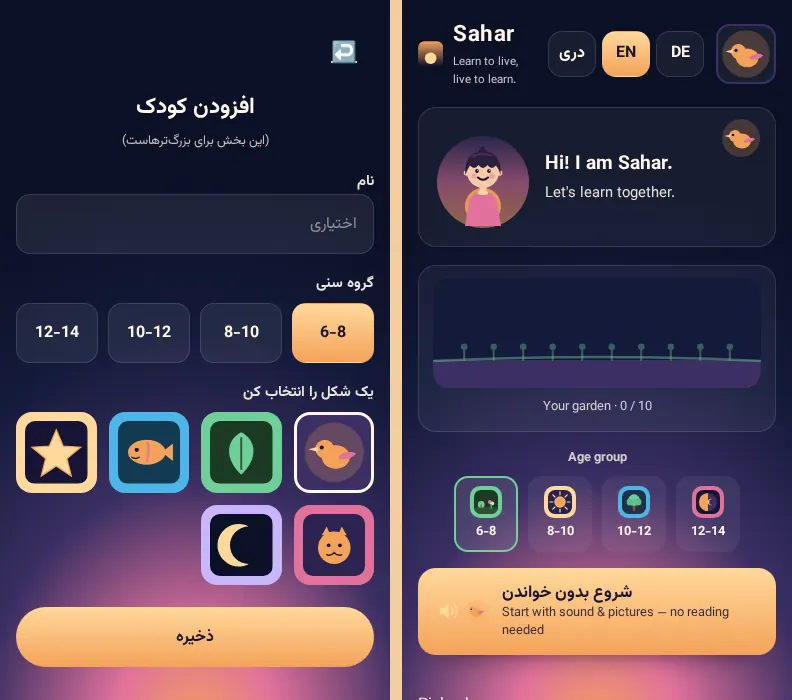

# Sahar — سحر

A free, text-first learning app for children denied school. Its prototype offers short lessons in literacy, numeracy, science and critical thinking, with a local learner profile and a choice of Dari/Persian (right to left), English or German.

## Quickstart

1. [Download the source ZIP](https://github.com/MohammadaliMasjedi-source/Sahar/archive/refs/heads/main.zip) and extract it, or clone this repository.
2. With Python 3 installed, open a terminal **inside the extracted Sahar folder** and run:
   ```sh
   python3 -m http.server 8000 --bind 127.0.0.1
   ```
   Open **http://127.0.0.1:8000/** on that same computer. On Windows with Python on PATH, you can instead double-click [Start-Sahar.cmd](Start-Sahar.cmd); it opens its own local address. Close the server window or press Ctrl+C when finished.
3. On first launch, tap **+**, choose an avatar and age band, and save. You can leave the name blank. Tap **EN** or **DE** at the top to change from Dari/Persian, then choose a lesson from the shelf. No sign-up or audio is needed.

**Want to help?** [Pick a contribution](CONTRIBUTING.md) · [See the contributor guides](contribute/README.md) · [Run the real-phone offline check](docs/PHONE-TEST.md). Software and device testing are useful even if you do not speak Dari; new learner-facing content follows the [human review process](contribute/REVIEWER-GATE.md).



*Two screens captured from a clean desktop Chromium session at a phone-sized viewport, using an unnamed demo profile. These are not physical-phone test results.*

**What works today:** the app serves lessons locally; use the local server for a first run, since opening the HTML as a file will not load the lesson packs reliably. The offline path has been exercised in a desktop browser. A real-device airplane-mode test and native-speaker review of human Dari narration remain open; see the [coverage record](SAHAR-COVERAGE-STATUS.md) and [audio notes](audio/DARI-AUDIO-SOURCING-2026-07-19.md). For the project's dependency-free Node test suite, run `npm test` from the repository root.

---

## The vision

**Sahar** (Dari/Persian: *سحر*, "dawn / the last hour before sunrise") is a **free, offline-first
education app for girls barred from school** — built first for Afghan girls shut out of school
since 2021, and for **any child anywhere denied an education.** It runs as a serious, game-like learning world
on a phone, tablet, or PC, **online or fully offline**, because the children who need it most often
have a borrowed phone, no data, and no permission to be seen learning.

The promise: a girl who starts at age 7 and stays with Sahar should, by the end, **know everything a
UN-"educated person" is meant to know** — literacy, numeracy, the sciences (Crash-Course breadth),
critical thinking, digital literacy, health and her own body, civics / economy / politics basics,
survival skills, the arts and literature, and a window into world languages — **plus** a shelf of
short illustrated companion books on thinking clearly, science, friendship, money, and survival.

### Motto
**"Learn to live, live to learn."** — یاد بگیر تا زندگی کنی، زندگی کن تا یاد بگیری.

### Languages
Persian / **Dari (RTL)**, English, German — at launch. Architected so a **5th and 6th language is a
file, not a rewrite.** Dari is first-class, not an afterthought.

### Age-tiered editions
Four editions so the same child grows up *inside* the app:

| Tier | Age | Heart of it |
|------|-----|-------------|
| **T1** | 7 | Letters, sounds, counting, "what is a question?" |
| **T2** | 8–9 | Reading sentences, arithmetic, the world around me |
| **T3** | 10–11 | Paragraphs, fractions, how things work, first science |
| **T4** | 12–13–14 | Algebra, the scientific method, the body, money, civics, media literacy |

---

## Who it is for

- Girls in Afghanistan locked out of secondary school since 2021.
- Refugee and displaced children with interrupted schooling.
- Any child — girl or boy — with a device but no school.
- Adults who never got the chance and want to start at the beginning, privately.

Designed **icon-first and low-literacy-friendly** so a child who *cannot yet read the menu* can still
start the first lesson. Designed **private by default** — nothing about using it is ever sent
anywhere, so no server, company, or outsider sees it. That does not make the device itself
invisible: like any app, Sahar leaves files on the phone or tablet until they are deleted — see
[`PRIVACY.md`](PRIVACY.md) for exactly what stays on the device and how to clear it.

---

## Not-for-profit, free forever

Sahar is **not a business.** It is free, with no ads, no tracking, no in-app purchases, and no data
sold — *ever*. The children are never the customer and never the product.

**How it is meant to be funded** (none of these touch the learner):

- Grants and educational foundations.
- UNICEF-style / NGO institutional partners who sponsor content packs and translations.
- **Diaspora "pay-it-forward":** Afghans and others abroad fund a child's pack, never their own access.
- Volunteer educators and translators contributing Open Educational Resources.

If money ever flows, it flows *toward* the child (devices, offline distribution, translation),
never *from* her.

---

## What's actually in this repo right now (honest inventory)

```
Sahar/
├─ README.md                  ← you are here
├─ LICENSE                    ← MIT (the code)
├─ LICENSE-CONTENT.md         ← CC-BY-SA 4.0 (the original learning packs)
├─ LICENSE-NOTE.md            ← how the dual license was decided
├─ SAHAR-COVERAGE-STATUS.md   ← honest, dated ticks of what is really done vs. still open
├─ package.json               ← defines `npm test` (the suites below + the teen-pack gate); no runtime dependencies
├─ docs/
│  ├─ ARCHITECTURE.md         ← offline-first PWA, Clean-Arch + MVVM, signed packs, i18n, Leitner, a11y, child-safety
│  ├─ NAME.md                 ← name shortlist + the Sahar-as-heroine idea
│  ├─ CURRICULUM-MAP.md       ← the UN "educated person" body of knowledge mapped to 4 tiers + companion books
│  ├─ CONTENT-MODEL.md        ← the audio-first card schema every pack follows (interaction, audio, caregiver line)
│  ├─ PHONE-TEST.md           ← the honest real-device / airplane-mode PWA checklist (not yet run)
│  └─ OSS-REUSE.md            ← concrete open-source to reuse, with licenses
├─ learning/
│  └─ PROJECT-EXPLAINED.md    ← the project explained in four layers (child → architect)
├─ handbook/                  ← maintainer handbook: overview, setup, standards, diagrams, task guides
├─ test/                      ← pure-Node headless suites (node:assert, no framework): 202 checks + a 36-check
│  │                             draft teen-pack gate = 238 via `npm test`, 0 failed
│  ├─ core.test.js            ← 29 — Leitner core, queue building, i18n parity, localStorage round-trip
│  ├─ bootstrap.test.js       ← 14 — language-course pack + the pre-literacy tap-round engine
│  ├─ content-validator.test.js  ← 134 — every pack: fa/en/de completeness, honest audio state, resolvable choices
│  └─ profiles.test.js        ← 25 — child profiles, age-band normalization, per-profile garden isolation
├─ content/                   ← versioned learning packs (fa/en/de), JSON — 10 Tier-1 + 4 Tier-2 + 1 language-course
│  ├─ t1-literacy-first-letters.json
│  ├─ t1-literacy-first-words.json
│  ├─ t1-numeracy-counting-0-20.json
│  ├─ t1-numeracy-shapes-patterns.json
│  ├─ t1-science-living-things.json
│  ├─ t1-science-day-and-night.json
│  ├─ t1-thinking-what-is-a-question.json
│  ├─ t1-thinking-fact-vs-guess.json
│  ├─ t1-life-healthy-and-safe.json    ← 9 curriculum packs: literacy ×2, numeracy ×2, science ×2, thinking ×2, life ×1
│  ├─ tier1-demo.json                  ← + one mixed demo pack = 10 Tier-1 packs
│  ├─ t2-literacy-reading-sentences.json
│  ├─ t2-numeracy-add-subtract.json
│  ├─ t2-thinking-fact-vs-opinion.json
│  ├─ t2-science-plants-habitats.json  ← 4 Tier-2 (8–10) packs, red-teamed 2026-07-14 — geography/life-skills/digital
│  │                                      literacy still open, tracked in `docs/COVERAGE-8-10-2026-07-14.md`
│  ├─ packs.manifest.json              ← single source of truth for which packs exist in which age band
│  └─ lc-fa-en-first-words.json        ← separate language-course pack: first English words taught through Dari
├─ audio/                     ← 245 machine-generated draft .mp3 clips + audio-manifest.json + RECORDING-MANIFEST.md — a temporary computer voice (fa is Iranian-Persian standing in for Dari), not real recordings
├─ fonts/                     ← Vazirmatn woff2 (Dari/Arabic + Latin), under the SIL Open Font License
├─ tools/
│  └─ generate-draft-audio.py ← edge-tts draft-audio generator (idempotent; never overwrites a real recording)
└─ (prototype — runnable, offline)
   ├─ index.html              ← the main app shell
   ├─ manifest.webmanifest    ← PWA manifest (inline-SVG icons, 192/512, maskable)
   ├─ sw.js                   ← cache-first service worker (precaches app shell + content + audio)
   ├─ app.js                  ← state + render + Leitner flow (logic separated from view)
   ├─ audio.js                ← playback chain: real recording → draft mp3 → TTS → tone
   ├─ mascot.js               ← the shared dawn-bird "Sahar" character (inline SVG)
   ├─ pictures.js             ← placeholder inline-SVG icons for the tap-the-picture cards
   ├─ styles.css              ← dawn palette, RTL-aware, design tokens
   ├─ bootstrap.html          ← pre-literacy first-contact language-course flow (its own entry point)
   ├─ bootstrap.js            ← that flow's view/glue …
   ├─ bootstrap-core.js       ← … and its pure, tested round engine
   ├─ bootstrap.css           ← shared tap-grid + progress-path styles (used by the main app too)
   ├─ teacher.html            ← printable teacher/parent sheet: what each Tier-1 pack teaches, fa/en/de
   └─ Start-Sahar.cmd         ← one-click Windows launcher (serve the folder, open the browser)
```

### The working prototype

Open **`index.html`** in any modern browser (double-click works; for full PWA/service-worker
behaviour serve the folder over `http://`). With **zero internet** you can:

- meet **Sahar**, the girl-at-dawn character (inline SVG, secular — no religious symbols);
- switch language **fa (RTL) / en / de** and watch every lesson re-render in all three;
- pick from a shelf of **ten Tier-1 packs** — first letters, first words, counting 0–20, shapes &
  patterns, living things, day & night, "what is a question?", "guess first, then check", and
  staying healthy & safe (nine curriculum packs across five subjects), plus a mixed demo pack; the
  **8–10 band (Tier 2)** adds **four packs** — reading sentences, adding & subtracting, fact vs.
  opinion, plants & habitats (geography, life-skills, and digital literacy for that band are still
  open, honest preview-only shells) — and a separate **language-course pack** (first English words
  taught through Dari);
- run a real **spaced-repetition card flow** (show → reveal → *got it / again*);
- see review progress **persist** in `localStorage` using a classic **Leitner box model**
  (`1 → 2 → 4 → 9 → 21` day intervals; *got it* climbs a box, *again* falls to box 1).

It is a **prototype**: ten Tier-1 packs, four Tier-2 packs, and a language-course pack, three
languages, the automated suite green (**238 headless checks, 0 failing as of 2026-08-11** — 29 core
+ 14 bootstrap + 134 content + 25 profiles, plus a 36-check draft gate for the teen pack; see
[`E2E-TEST-REPORT.md`](E2E-TEST-REPORT.md) for what those checks do and do not cover — a known
same-day-replay scheduling gap and an audio false-success edge case are open, tracked as
`TASKS.md` T-SAHAR-06/07). Every card now has **draft machine-voice audio** (fa/en/de), flagged
in-app as a temporary computer voice — the Dari voice is Iranian-Persian standing in for real
recordings, not the finished thing, and it is optional: every lesson works with audio off (v1 is
text-first). The full curriculum, the pack-signing pipeline, **real human Dari audio** (a
funded-phase deliverable), and Tiers 3–4 are documented but **not yet built**; Tier 2 (8–10) has
four content packs shipped and red-teamed (2026-07-14) — geography, life-skills, and digital
literacy for that band remain open, see [`docs/COVERAGE-8-10-2026-07-14.md`](docs/COVERAGE-8-10-2026-07-14.md).

---

## Architecture, in one breath

Offline-first **PWA** · Clean-Architecture-ish + MVVM in one file (logic separated from view, see
`app.js`'s header) · content shipped as **versioned JSON packs** downloaded per age-tier so a phone
stores only what it needs — **pack signing is designed but not yet built** (`app.js` loads
`"signature": null` packs today; see `docs/ARCHITECTURE.md` §4) · **i18n from day one** (fa-RTL / en
/ de) · spaced repetition on a classic **Leitner box engine** (a known same-day-replay gap is open,
`TASKS.md` T-SAHAR-06) · accessibility and **low-literacy icon-first UX** (a formal WCAG audit is
still open, `TASKS.md` T-SAHAR-03) · **privacy by default — no tracking, no ads, no accounts
required.** See [`docs/ARCHITECTURE.md`](docs/ARCHITECTURE.md).

---

## Ownership & License

**Owner / copyright holder: Mohammadali Masjedi** — © 2026. Sahar is an independent,
not-for-profit project; it is not owned by any company, institution, or employer. The maintainer
holds the copyright and is the point of contact for the Digital Public Goods submission.

Dual-licensed on purpose, so the engine travels far and the lessons stay free:

- **Code → [MIT](LICENSE).** Fork it, build your own Sahar for your own denied children.
- **Original learning packs → [CC-BY-SA 4.0](LICENSE-CONTENT.md).** Use and adapt them freely,
  credit the source, and keep derivatives free under the same terms.

See [`LICENSE-NOTE.md`](LICENSE-NOTE.md) for the reasoning, and
[`SDG-MAPPING.md`](SDG-MAPPING.md) · [`PRIVACY.md`](PRIVACY.md) · [`DO-NO-HARM.md`](DO-NO-HARM.md) ·
[`DATA-HANDLING.md`](DATA-HANDLING.md) · [`PLATFORM-INDEPENDENCE.md`](PLATFORM-INDEPENDENCE.md) for
the Digital Public Goods readiness docs.

## Contributors

Sahar is built in the open, and community help makes it better and safer for the children who use it.

- **[Mahyar](https://github.com/mahyar9272)** — end-to-end testing and hardening
  ([#1](https://github.com/MohammadaliMasjedi-source/Sahar/pull/1)): fixed a timezone bug that
  drifted the Leitner "today" by a day for learners east of UTC (with a regression test), added a
  re-tap lock so a child mashing tiles can't skip cards, corrected the garden progress count so it
  can never exceed a band's total, and closed an HTML-escaping gap in lesson titles. Thank you. 🌱

Contributions are welcome — see [`CONTRIBUTING.md`](CONTRIBUTING.md).

---

*For the girls who were told to stop. Learn to live, live to learn.*
