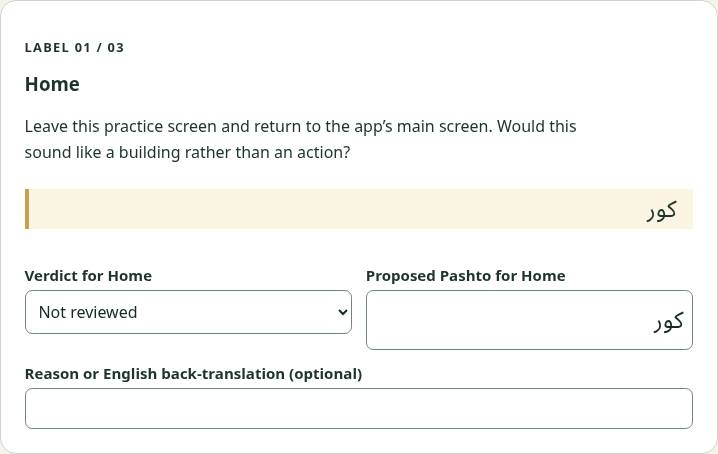

# Pashto label workshop · adult contributors

Can someone tell **play** from **replay**, and understand **home** as a destination? Help Sahar try three real control labels in Afghan Pashto (`ps-AF`), a language named in its [architecture](../../docs/ARCHITECTURE.md). An adult native speaker can help with **one label in five minutes**. The learner app has not acquired a Pashto mode, voice or lessons.

**[Leave one judgment on issue #5](https://github.com/MohammadaliMasjedi-source/Sahar/issues/5)** — works without installing anything. These three candidates are unreviewed suggestions, not a glossary or model answers.

| Key in the [bootstrap UI](../../bootstrap.js) | English source | Candidate | Context to test |
|---|---|---|---|
| `home` | Home | کور | Does it mean *return to the main screen*, rather than a physical home? |
| `listen` | Listen | واوره | Is this a natural control label for playing a prompt? |
| `again` | Hear again | بیا یې واوره | Is replaying the same sound clearly distinct from restarting the exercise? |

Example **reply format**: `key / keep, change or unsure / your wording if different / optional explanation or back-translation`. A GitHub handle is enough; do not provide personal details, recordings or information about children.

**Try the editable version:** Download/extract the branch ZIP or clone the repository, then double-click `contribute/pashto-review/index.html` inside the extracted folder. CSS and scripts sit alongside it; no server, network, installation or account is needed to run it. Try a different wording, choose a verdict, and build a review note. Nothing is saved or sent by the worksheet; copy your note before leaving. At phone width, check that Pashto reads right-to-left while the English guidance stays left-to-right.

**Where feedback goes:** A maintainer reconciles proposed wording and disagreements with an adult native speaker. A second opinion is welcome where regional usage or the button’s meaning is uncertain. Do not enable an app locale from these notes. Apply the [human review gate](../REVIEWER-GATE.md) and [translation standard](../PROTOCOLS-AND-STANDARDS.md) to any future learner release; this worksheet never records a sign-off. No audio, lessons or child testing are part of this task.

Developer check from the repo root: `node --test test/pashto-review.test.js`. The tests pin the three English source labels, cover review note generation, and check separation from the learner app.
